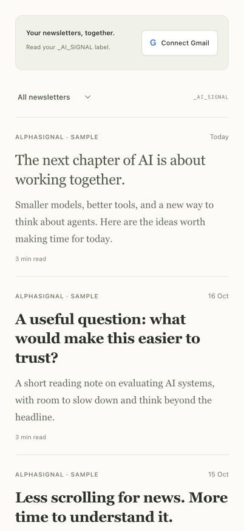
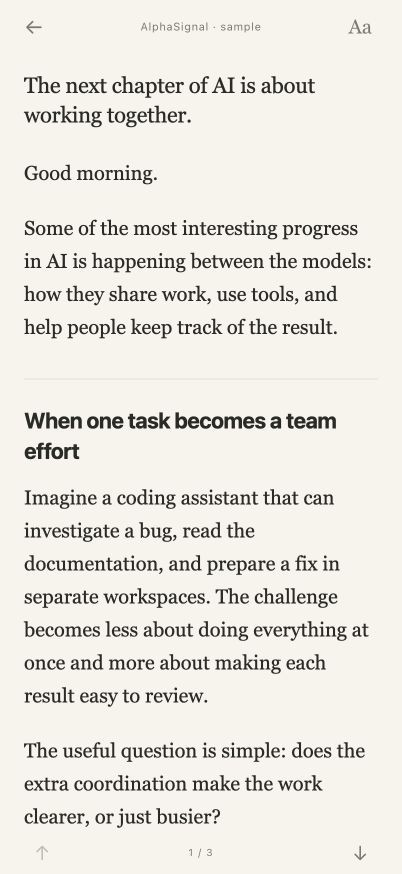

# AI Signal — Newsletter reader

**Read your Gmail newsletters like a book.**

[](https://github.com/bforbesc/ai-signal/actions/workflows/web.yml)
[](LICENSE)
[](PRIVACY.md)

An open-source **Gmail newsletter reader** for **multiple publications, on any topic**. Apply the `_AI_SIGNAL` label to the newsletters you want, read them in one quiet feed, or filter by publication. It works in a browser and can live on your iPhone Home Screen.

[Overview](https://bforbesc.github.io/ai-signal/) · [Set up your own](https://bforbesc.github.io/ai-signal/setup.html) · [Development](docs/DEVELOPMENT.md) · [Privacy](PRIVACY.md)

## Demo

**Your newsletter feed → your reading space.** Tap either screenshot to see it full size.

<p>
  <a href="docs/images/feed-preview.jpg"></a>
  <a href="docs/images/reader-preview.jpg"></a>
</p>

*Screenshots use original, fictional sample editions. No private email is shown.*

## What it does

- Combines multiple newsletter publications from one Gmail account, newest first.
- Detects publications automatically and lets you filter by newsletter.
- Shows unread titles in bold and marks an edition read in Gmail when you open it.
- Offers a clean reading view with soft section dividers, plus the original email layout.
- Remembers text size, default view and image preferences on your device.
- Keeps article links working and removes common signup menus and email footers.
- Keeps the newest 30 editions cached on your device, refreshes in the background, and loads older editions as you scroll.
- Restores your Gmail connection when you return to a configured private deployment.

You read the original writing. There are no generated summaries, email sending or notifications.

Read status comes from Gmail and syncs across devices when refreshed. Open a newsletter by tapping its title or preview text. To mark it unread again, use **Aa → Mark as unread** in the reader. The fictional demo keeps its own local read state. Existing read-only connections show a **Reconnect Gmail** prompt to enable status sync.

## Why I built it

I built AI Signal for myself because I didn't want to pay for [Meco](https://meco.app/). I only needed a Gmail newsletter feed and a comfortable place to read, so I made a small personal reader around those features.

I use it for AI news, which is where the name comes from. You can use it for research, business, culture or any other newsletter topic, with one publication or several.

AI Signal is an independent project, unaffiliated with Meco. The label is currently fixed as `_AI_SIGNAL`, including for newsletters about other topics. Email layouts vary; see the [current limits](docs/DEVELOPMENT.md#current-limits).

## Set up your own reader

This is an **open-source personal app template**. You deploy your own copy and connect your own Gmail account. The author's installation is private.

The current hosting setup uses **Codex with the Sites plugin**. You also need a Google account, a Google Cloud project with Gmail API enabled, and your own web OAuth client. Hosting and account requirements depend on your provider; this is not an App Store app.

1. **Deploy your own reader.** Fork this repository and follow the [setup guide](https://bforbesc.github.io/ai-signal/setup.html). Create a new private Sites project; do not reuse the author's project ID or Google configuration. Your source fork can remain public.
2. **Connect your Gmail.** Configure your OAuth client and protected server settings, then tap **Connect Gmail** in your reader.
3. **Label your newsletters.** In Gmail, create `_AI_SIGNAL` and apply it to the editions you want to read. A Gmail filter can label future emails automatically.
4. **Read on your phone.** Open your reader in Chrome or Safari and use **Share → Add to Home Screen**.

The [full guide](https://bforbesc.github.io/ai-signal/setup.html) includes the Google Cloud fields, callback URL, persistent-login setup and common fixes. No Apple Developer membership is needed.

## Try the sample locally

You can explore the reading experience without connecting Gmail. Use Node.js **22.23 or newer**:

```sh
git clone https://github.com/bforbesc/ai-signal.git
cd ai-signal
npm ci
```

Create an ignored `.dev.vars` file containing:

```dotenv
APP_ORIGIN=http://127.0.0.1:5173
```

Then start the preview:

```sh
npm run dev -- --hostname 127.0.0.1 --port 5173
```

Open [the local preview](http://127.0.0.1:5173/signin-with-chatgpt?return_to=/) to enable a simulated local identity and read the sample editions. No real ChatGPT or Gmail sign-in is needed for the sample. To connect real mail, finish your own Google/server setup first. See [Development](docs/DEVELOPMENT.md) for local database setup and deployment details.

## Your data

Gmail status sync requires Google's `gmail.modify` permission, which is broader than read-only access. It can permit reading, composing, sending and moving email to Trash. AI Signal's server exposes only reads from `_AI_SIGNAL` and changes to the `UNREAD` flag on messages in that label; it has no sending or deletion routes. A configured server stores an encrypted connection so it can renew access.

The latest 30 editions, including their text, are stored in this browser’s IndexedDB cache, separately for each Gmail account. Older editions are fetched on demand. New editions are checked on reopening/returning and every ten minutes while the app is visible; the closed app does not poll Gmail. Remote images are off by default. **Sign out** deletes your saved connection and clears that account’s device cache. You can also revoke access in your Google Account. Read the [privacy notice](PRIVACY.md) for details.

The code currently relies on Sites authentication. Deploying it on a different host requires implementing and reviewing a trusted identity boundary first; uploading it to a static host will not provide persistent Gmail login.

## Working on the project

```sh
npm run check:secrets
npm run typecheck
npm test
npm run build
```

Architecture, configuration, migrations and current limits are documented in [Development](docs/DEVELOPMENT.md). To report an issue, include your browser, the steps and a redacted screenshot. Keep private emails and credentials out of public issues.

## Licence

[MIT](LICENSE) — use, adapt and share your own copy. Keep the licence and copyright notice. Third-party dependencies retain their own licences.
